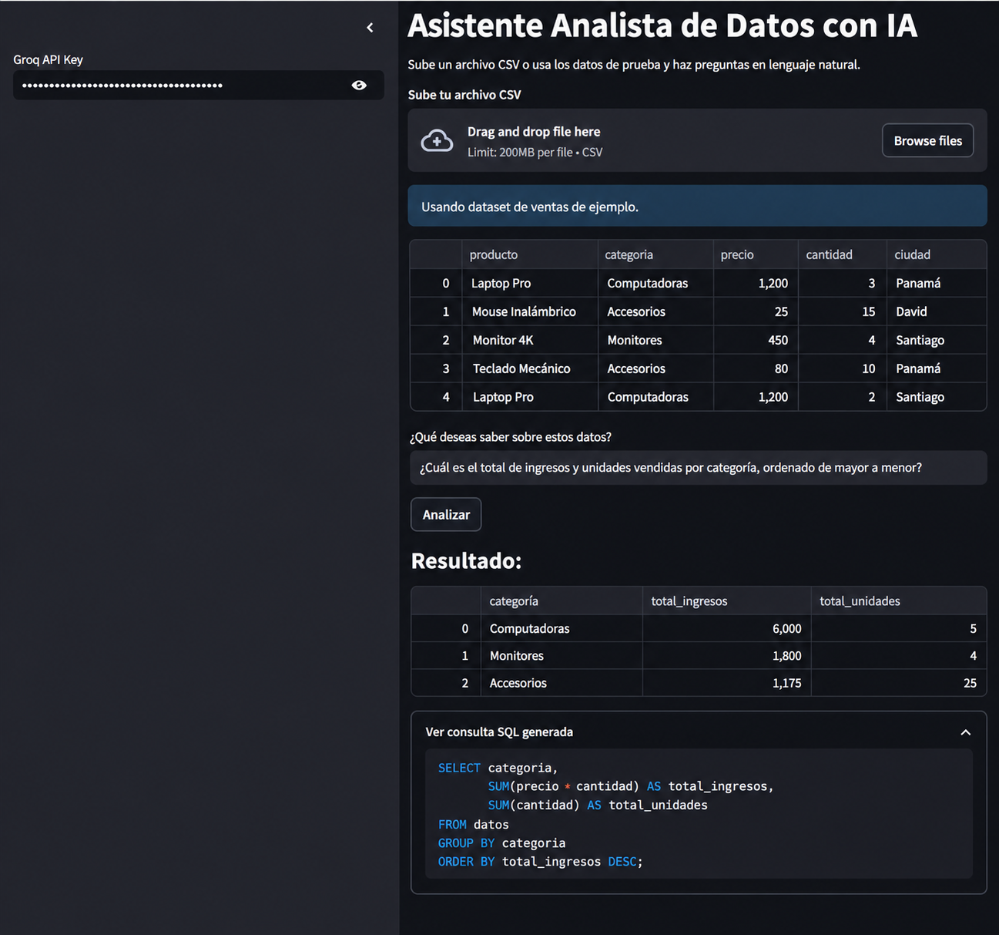
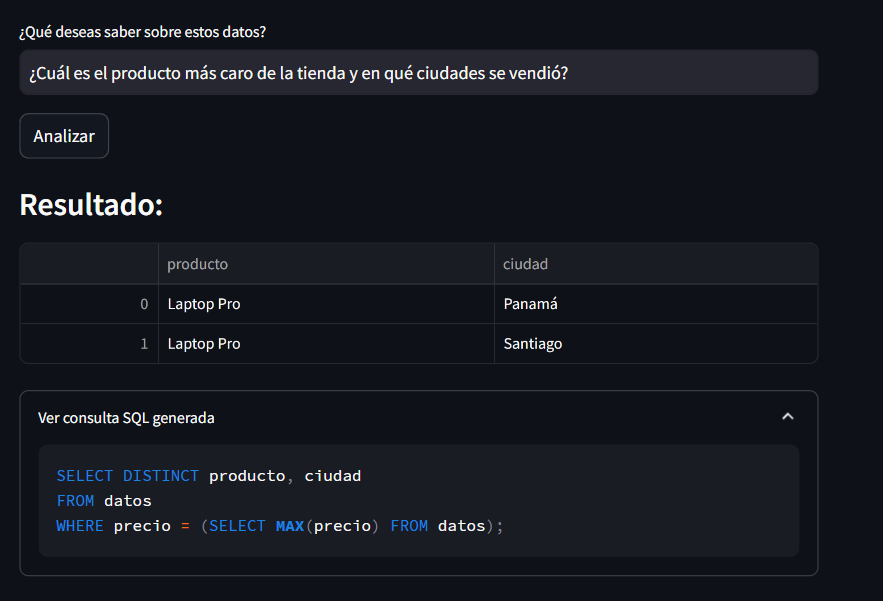
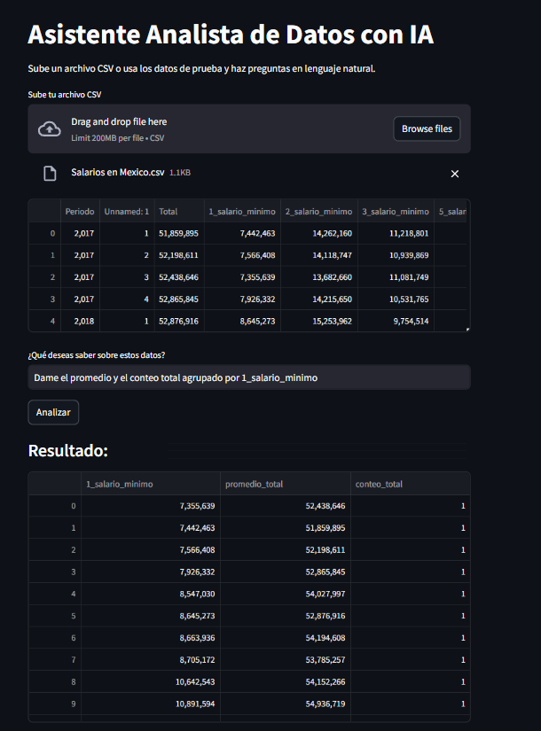
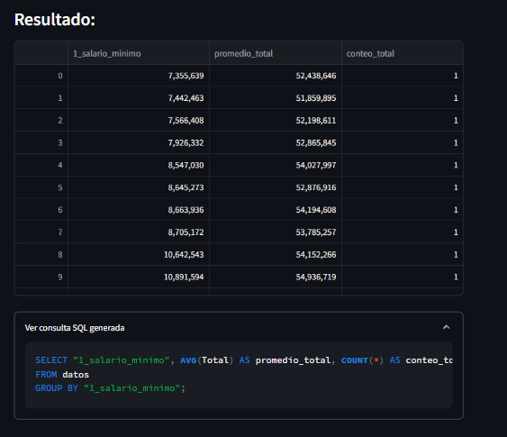

# AI Data Analyst Assistant

Asistente conversacional inteligente diseñado para democratizar el análisis de datos. Permite a usuarios sin conocimientos técnicos consultar archivos CSV y bases de datos SQL utilizando lenguaje natural.

## Características
- **Text-to-SQL en tiempo real:** Convierte preguntas en español a consultas SQL optimizadas mediante inferencia ultrarrápida.
- **Carga dinámica de datos:** Soporte para archivos `.csv` personalizados o dataset de demostración integrado.
- **Ejecución segura:** Procesamiento en memoria mediante SQLite y Pandas sin riesgo para bases de datos externas.
- **Transparencia:** Muestra tanto la tabla de resultados calculados como la consulta SQL exacta generada por la IA.

## Demostración en Acción

### 1. Vista general y agregaciones


### 2. Consultas complejas y filtros


### 3. Carga dinámica de archivos CSV externos


### 4. Generación automática de consultas SQL


## Stack Tecnológico
- **Lenguaje:** Python 3.11+
- **Frontend:** Streamlit
- **IA / LLM:** Groq API (`openai/gpt-oss-120b`)
- **Datos:** Pandas & SQLite

## Instalación y Uso Local

1. **Clona el repositorio:**
   ```bash
   git clone https://github.com/linceavila9-source/ai-data-analyst-assistant.git
   cd ai-data-analyst-assistant
   ```

2. **Instala las dependencias:**
   ```bash
   pip install -r requirements.txt
   ```

3. **Configura tus variables de entorno:**
   Renombra `.env.example` a `.env` y agrega tu clave de API de Groq:
   ```env
   GROQ_API_KEY=gsk_tu_clave_secreta
   ```

4. **Ejecuta la aplicación:**
   ```bash
   python -m streamlit run app.py
   ```

## Contribuciones
Las contribuciones son bienvenidas. Si tienes ideas para agregar soporte a PostgreSQL o gráficos automáticos, abre un *Issue* o envía un *Pull Request*.

---
Desarrollado por **[Lince Ávila](https://github.com)** 
